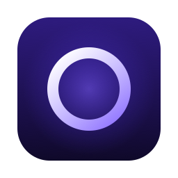
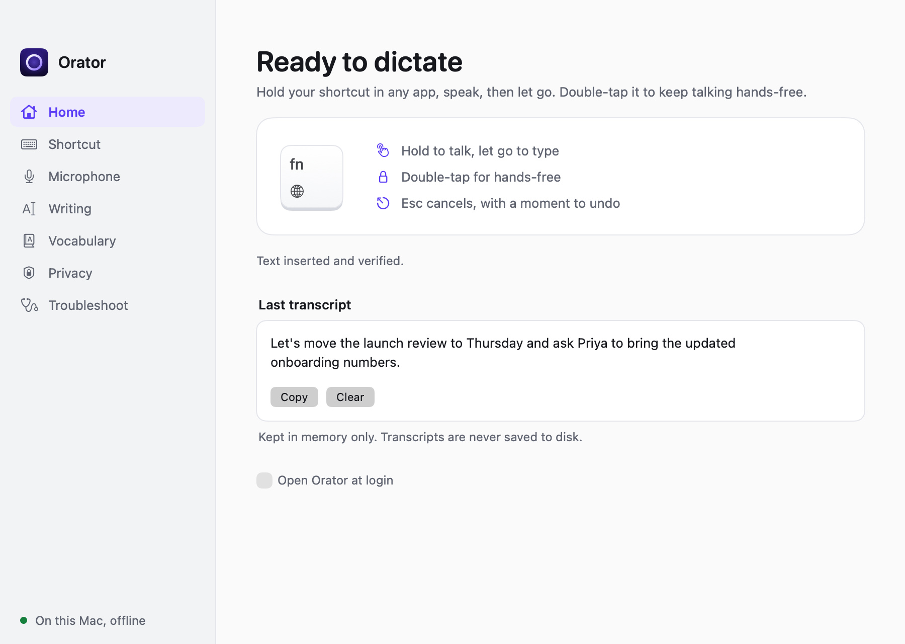
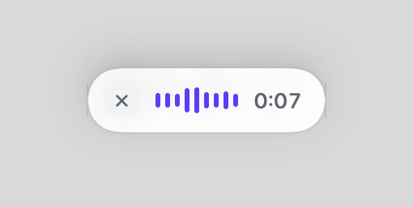
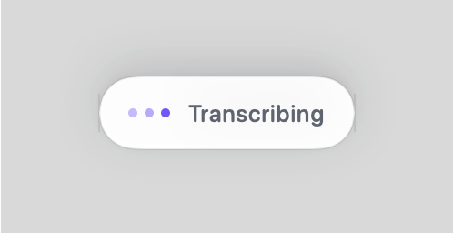

<p align="center">
  
</p>

<h1 align="center">Orator</h1>

<p align="center">
  Private, on-device dictation for macOS.<br>
  Hold a key, speak, let go. Your words appear in whatever app you're using.
</p>

<p align="center">
  <a href="https://github.com/DevStrategist/orator/releases/latest"><b>Download for Mac</b></a>
  &nbsp;·&nbsp; Apple Silicon &nbsp;·&nbsp; macOS 14 or later &nbsp;·&nbsp; MIT License
</p>

<p align="center">
  
</p>

## Why Orator

- **Nothing leaves your Mac.** Speech recognition runs locally with NVIDIA's Parakeet model on Apple's MLX. There's no account, no server and no telemetry.
- **Works in any app.** Orator types into the field you were using: editors, browsers, chat apps, terminals, and remote desktop viewers.
- **Feels instant.** Hold your shortcut and start talking. A small pill shows your voice while you speak, then disappears once your words are in.
- **Gets out of your way.** A quick tap is ignored, a double-tap keeps it listening hands-free, and Escape cancels with a moment to undo.

<p align="center">
  
  
</p>

## Install

1. Download the **Orator** disk image (`.dmg`) from the [latest release](https://github.com/DevStrategist/orator/releases/latest).
2. Open it and drag **Orator** into **Applications**.
3. Open Orator. It asks for two permissions:
   - **Microphone**, so it can hear you.
   - **Accessibility**, so it can type into other apps.
4. On first launch, Orator sets up its speech engine and downloads the speech model (about 1.3 GB in total, once). After that it works fully offline.

Then hold **fn** (or your chosen shortcut) in any app and speak.

**Requirements:** a Mac with Apple Silicon, macOS 14 Sonoma or later, about 2 GB of free disk space. 8 GB of memory is plenty.

## Using Orator

| Action | What happens |
| --- | --- |
| Hold the shortcut | Orator listens while you hold it and types when you let go. |
| Double-tap the shortcut | Hands-free mode. Press once more to finish. |
| Quick tap | Ignored, so stray presses never start a dictation. |
| Escape while speaking | Cancels. An **Undo** button appears for a few seconds. |

The default shortcut is **fn**. You can pick any modifier, a key combination, or Caps Lock on the **Shortcut** page.

### Thoughtful details

- **Matches the surrounding text.** When you dictate mid-sentence, Orator adds the space and lowercases the first word.
- **Learns your words.** Correct a dictated word and Orator offers to add the fix to your vocabulary.
- **Protects your clipboard.** It restores what you had copied, and never overwrites something newer.
- **Never types in the wrong place.** If focus moves before your words arrive, the transcript stays in Orator for you to copy.
- **Explains problems plainly.** It tells you when the mic is muted, the lid is closed, another app holds the microphone, or Secure Keyboard Entry is blocking shortcuts.
- **Recovers audio.** If something fails, the recording is kept for 24 hours so you can transcribe it again.
- **Optional quiet mode.** Pause Spotify or Music, or mute other audio, while you dictate.

## Privacy

- Audio is recorded only while you hold the shortcut. It's written to private temporary files and deleted as soon as the text is delivered.
- Failed recordings are kept for up to 24 hours so you can recover them, or not at all if you turn that off.
- Transcripts are kept in memory only and never saved to disk.
- The speech engine runs in a separate process that is blocked from making network connections.
- The only downloads happen once, during setup: the Python runtime and a pinned, checksum-verified build of the model.

## Speech model

Orator uses NVIDIA's Parakeet TDT 0.6B v3 with its encoder quantized to 8 bits. The quantized build is published as a [release asset](https://github.com/DevStrategist/orator/releases/tag/speech-model-v1) and can be reproduced with `scripts/quantize_model.py`. On an Apple Silicon MacBook, against the full-precision weights:

| | Full precision | 8-bit encoder (used) |
| --- | --- | --- |
| Download | 2.5 GB | 755 MB |
| Memory while transcribing | 1.9 GB | 1.1 GB |
| Speed | 16× real time | 22× real time |
| Model load | 2.7 s | 0.5 s |
| Transcripts | Reference | Identical on every benchmark clip |

## Build from source

You'll need Xcode 15 or later (or the Swift 5.9 toolchain), [uv](https://docs.astral.sh/uv/), and a code-signing certificate. Without a stable signature, macOS forgets permissions after every rebuild.

```sh
git clone https://github.com/DevStrategist/orator.git
cd orator
scripts/install.sh      # builds, signs and installs to ~/Applications, then launches
scripts/test.sh         # Swift and Python test suites
```

To produce a notarized disk image, store notary credentials once and run the release script:

```sh
xcrun notarytool store-credentials orator --apple-id <email> --team-id <team>
scripts/release.sh      # dist/Orator-<version>.dmg
```

## How it works

Orator runs as three small processes that talk over JSON lines:

| Process | Role |
| --- | --- |
| **Orator** (Swift, AppKit + SwiftUI) | Shortcut handling, session state, the pill and settings, and text insertion through Accessibility with a verified clipboard fallback. |
| **Orator Capture** (Swift) | Records 16 kHz mono PCM with AVAudioEngine. Handles device changes, retries a microphone that won't start, and detects a silent one. |
| **Speech worker** (Python, MLX) | Runs Parakeet TDT 0.6B v3 with chunked inference for long dictations. No network access. |

Each recording belongs to a single session ID, and every asynchronous result is checked against it. A late result can never be inserted into the wrong place or twice. If a helper crashes, it restarts automatically, and the audio from that session is kept for recovery.

```
Sources/
  Orator/          App, shortcut handling, insertion, UI
  OratorCapture/   Microphone capture helper
  OratorCore/      Pure, tested policies (sessions, gestures, smart text, settings)
runtime/           Speech worker and its locked Python dependencies
scripts/           Build, install, test and release
```

## Acknowledgements

Orator builds on [Parakeet-MLX](https://github.com/senstella/parakeet-mlx), [MLX](https://github.com/ml-explore/mlx) and [uv](https://github.com/astral-sh/uv). The [Parakeet TDT 0.6B v3](https://huggingface.co/nvidia/parakeet-tdt-0.6b-v3) model by NVIDIA is licensed under CC BY 4.0. See [Resources/ThirdPartyNotices.txt](Resources/ThirdPartyNotices.txt) for details.

## License

Orator is available under the [MIT License](LICENSE).
